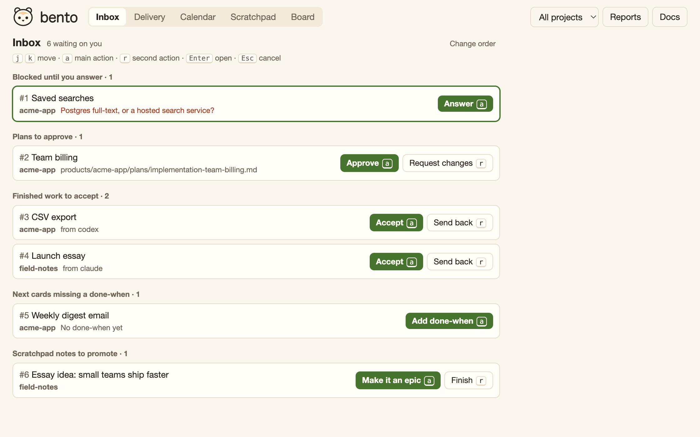

# bento

A tidy little box for what's next.



## Why this exists

Bento is the AI harness for people who think like a PM. That's how I work. I'm the product person, and Claude Code and Codex are my builders and testers across several products at once. The tools for keeping that work straight didn't fit, so I built this.

- **Trackers are too much.** Linear is too much for one person and a few agents. That setup needs a queue everyone can read, not a system to administer.
- **Agents don't share a queue.** A Claude session can't see what a Codex session picked up. I was the one keeping the order in my head.
- **Handoffs have no home.** A common one: I iterate in Codex, then hand a set of epics to Claude with an implementation doc. That handoff shouldn't depend on me copying text between windows.
- **Checking on agents is a chore.** Work finishes while I'm elsewhere, and nobody tells the session that was waiting. A session should hear back when the work is done, without polling.
- **Product docs drift.** Backlogs and release plans live in each repo, with a copy in every worktree and branch. One of my backlogs still listed shipped work as unmerged.
- **My own tracking was on paper.** Agents can't read a sticky note.
- **Release dates don't line up.** I often time writing to warm up an audience before a product release. Working backward takes apps and writing on one calendar, with dependencies you can see.

## What it is

Bento is a kanban board and product-doc home that you and your coding agents can all read and write. It's plain Markdown on your own machine, with one small script and a web board. No accounts, servers, or dependencies beyond Python 3.9+ and git.

- **One view across projects**, filterable down to one.
- **Epics, not tickets.** Each card is a meaningful group of work with a clear "done when".
- **Implementation, testing, release, and writing plans**, pulled from your backlogs and roadmaps.
- **Agent handoffs.** Iterate with one agent, then hand epics and a plan to another.
- **Safe claiming**, so two agents can't take the same card.
- **Delivery view:** what to take up next, what each item still needs from you, and what is ready to verify.
- **Calendar view:** milestones across projects, and how the work feeding each one stands.
- **Edit docs your way:** write on the board itself, or start a Codex or Claude Code thread on any doc.
- **Scratchpad:** loose notes and ideas, any of which can become an epic.

## Requirements

- Python 3.9+ and git.
- Claude Code, Codex, or both.
- macOS. That's where Bento is built and tested. Linux is untested. Windows won't work, because Bento relies on Unix file locks.

## Setup

```bash
git clone https://github.com/ckoglmeier/bento.git ~/bento
mkdir -p ~/.local/bin
ln -s ~/bento/kb ~/.local/bin/kb
kb init ~/bento-data --owner yourname
kb install-agents
```

If your shell can't find `kb`, add that folder to your path and open a new terminal:

```bash
echo 'export PATH="$HOME/.local/bin:$PATH"' >> ~/.zshrc
```

The tool and your data stay separate. This repo holds only code. Your board, docs, and plans live in a workspace folder on your machine. While it runs, Bento snapshots that folder to its own local git repo about once a minute. It never pushes those snapshots anywhere.

`kb install-agents` adds a short marked section to `~/.claude/CLAUDE.md` and `~/.codex/AGENTS.md`, and lets Codex's sandbox write to the workspace.

## First five minutes

1. Connect a project and open the board:

   ```bash
   kb connect ~/code/my-app --import-docs
   kb open
   ```

   Later, `kb open` or telling your agent "open bento" brings the board back up. Saying "note for bento" saves a summary of the discussion to your Scratchpad.

2. In that project, ask Claude Code or Codex: "Read our backlog and add the next few epics to Bento." They land in Backlog.
3. On the board, drag the one you want first into Next.
4. Ask your agent "What's next?" It answers from the board and changes nothing. Tell it to pick the work up, and it claims the card and finishes into Review for you to check.

## Update or remove

```bash
cd ~/bento && git pull
```

`kb uninstall-agents` removes what `kb install-agents` added and leaves your workspace alone. `kb service uninstall` stops the background service if you turned it on.

## Docs

The [docs](https://buildwithbento.com/docs) cover how the board works, plans, handoffs, hearing back without polling, milestones, recurring reports, and every command. The rules agents follow are in [AGENTS.md](AGENTS.md), and `kb rules` prints them.

## Support

I built this for my own work. Issues are welcome, and support is best effort.

## License

[MIT](LICENSE)
